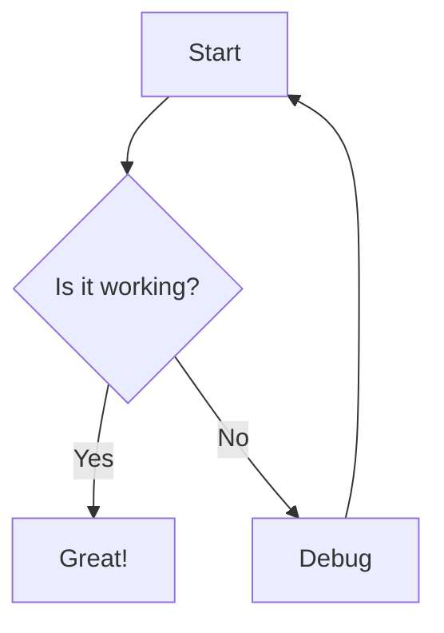
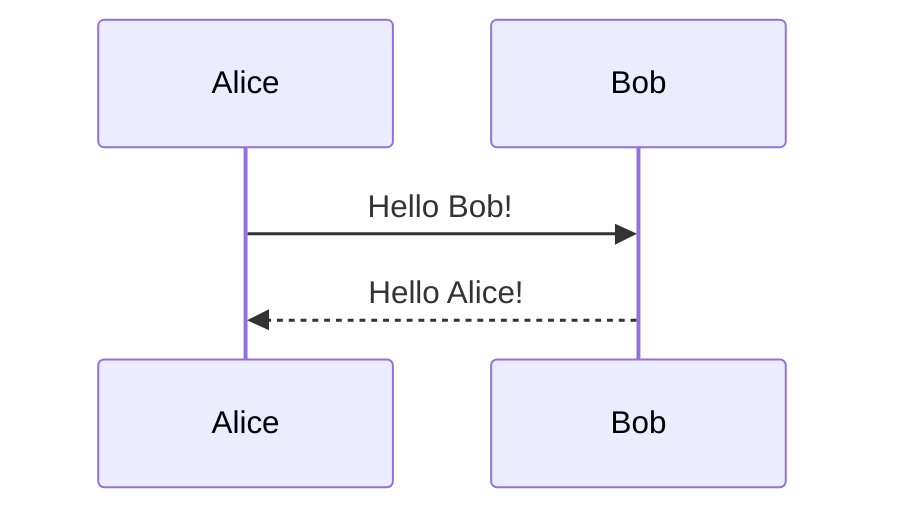
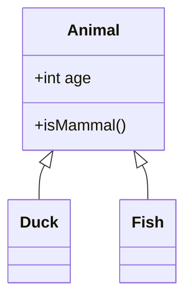
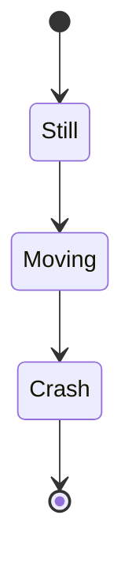
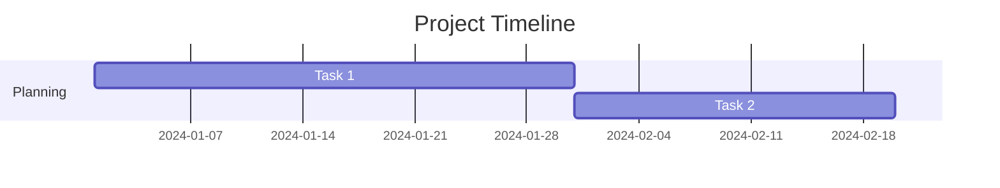
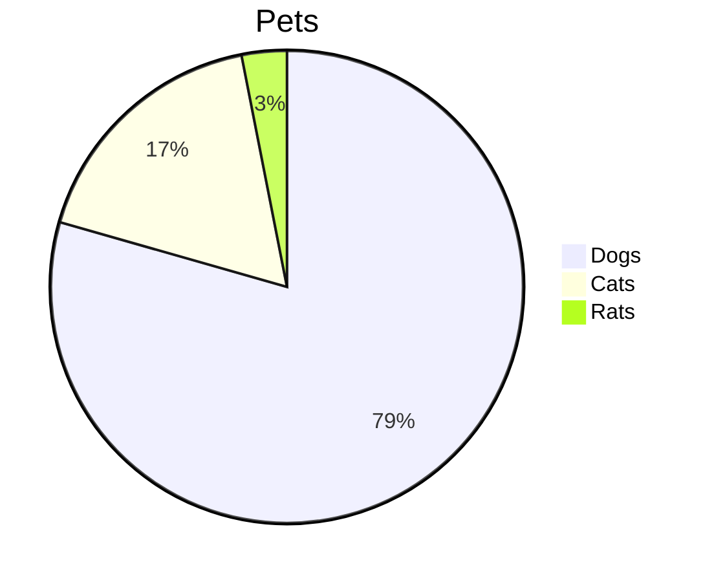
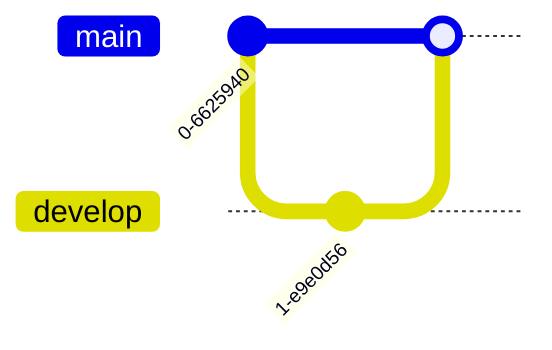
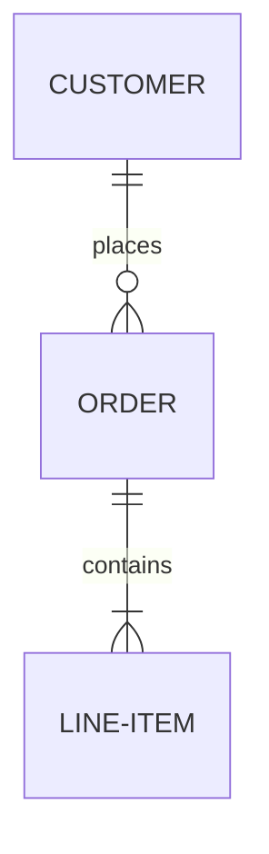
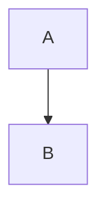

The `comark/plugins/mermaid` plugin renders [Mermaid](https://mermaid.js.org/) diagrams from ` ```mermaid ` code blocks. Diagrams render client-side via the `<Mermaid>` component exported alongside the plugin.

::note
[`beautiful-mermaid`](https://github.com/lukilabs/beautiful-mermaid) is a peer dependency. Install it alongside Comark with `npm install beautiful-mermaid`.
::

## Usage

```typescript
import { parseMarkdown } from 'comark'
import mermaid from 'comark/plugins/mermaid'

const result = await parseMarkdown(content, {
  plugins: [mermaid()]
})
```

With framework components, pass both the plugin and the `Mermaid` renderer component:

::code-group

```vue [Vue]
<script setup lang="ts">
import { Markdown } from '@comark/vue'
import mermaid, { Mermaid } from '@comark/vue/plugins/mermaid'
</script>

<template>
  <Suspense>
    <Markdown
      :components="{ mermaid: Mermaid }"
      :plugins="[mermaid()]"
    >{{ content }}</Markdown>
  </Suspense>
</template>
```

```tsx [React]
import { Markdown } from '@comark/react'
import mermaid, { Mermaid } from '@comark/react/plugins/mermaid'

<Markdown
  components={{ mermaid: Mermaid }}
  plugins={[mermaid()]}
>
  {content}
</Markdown>
```

```svelte [Svelte]
<script lang="ts">
  import { Markdown } from '@comark/svelte'
  import mermaid, { Mermaid } from '@comark/svelte/plugins/mermaid'
</script>

<Markdown {content} components={{ mermaid: Mermaid }} plugins={[mermaid()]} />
```

::

---

## Features

### Diagram types

Supported diagram types include:

**Flowchart**

````markdown

````

**Sequence diagram**

````markdown

````

**Class diagram**

````markdown

````

**State diagram**

````markdown

````

**Gantt chart**

````markdown

````

**Pie chart**

````markdown

````

**Git graph**

````markdown

````

**ER diagram**

````markdown

````

See the [Mermaid documentation](https://mermaid.js.org/intro/) for the syntax reference for each diagram type.

### Code block attributes

Pass component props directly on the opening fence:

````markdown

````

---

## API

### `mermaid(options?)`

Returns a `ComarkPlugin` that marks ` ```mermaid ` code blocks for custom rendering.

**Parameters:**

- `options?`: Optional `MermaidConfig`:
  - `theme?: ThemeNames`: Sets the `theme` attribute on every diagram node, passed as a prop to the `<Mermaid>` component
  - `themeDark?: ThemeNames`: Sets the `theme-dark` attribute, used in dark mode

**Returns:** `ComarkPlugin`

The plugin converts `mermaid` code blocks into AST nodes that the `<Mermaid>` component renders. Rendering requires passing `Mermaid` to the `components` prop of `<Markdown>` (see [Usage](#usage)).

---

## Component props

Props accepted by the `<Mermaid>` component:

| Prop | Type | Default | Description |
|---|---|---|---|
| `content` | `string` | required | The Mermaid diagram source |
| `theme` | `string` | `undefined` | Mermaid theme. Defaults to `tokyo-light` (`tokyo-night` in dark mode). See [available themes](https://github.com/lukilabs/beautiful-mermaid#built-in-themes) |
| `themeDark` | `string` | `undefined` | Theme to use in dark mode |
| `width` | `string` | `'100%'` | Container width |
| `height` | `string` | `'auto'` | Container height |
| `class` | `string` | `''` | CSS classes for the container |

---

## Examples

::card{icon="i-simple-icons-mermaid" title="Vue + Vite Mermaid" to="/examples/plugins/vue-vite-mermaid"}
Runnable Vue and Vite example rendering multiple Mermaid diagram types.
::
