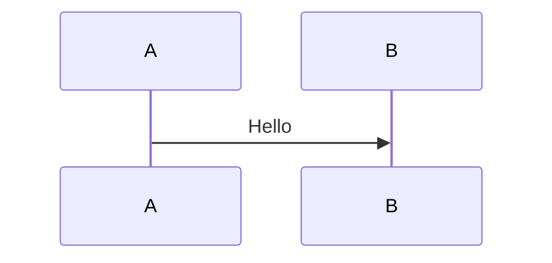

# Mermaid diagrams in React and Vite

This example renders fenced `mermaid` code blocks as SVG diagrams in React and Vite using `@comark/react/plugins/mermaid` and `beautiful-mermaid`.

## Features

- Parses fenced `mermaid` code blocks into `Mermaid` nodes with the `mermaid` plugin.
- Renders flowcharts, sequence diagrams, state diagrams, and class diagrams as SVG through the `Mermaid` React component.
- Accepts per-diagram theme, width, and height props in the fence info string.

## Usage

1. Install the renderer and `beautiful-mermaid` peer dependency:
   ```bash
   npm install @comark/react beautiful-mermaid
   ```

2. Import the `mermaid` plugin and `Mermaid` component:
   ```tsx
   import { MarkdownClient } from '@comark/react'
   import mermaid, { Mermaid } from '@comark/react/plugins/mermaid'
   ```

3. Pass the plugin and component to `MarkdownClient`:
   ```tsx
   <MarkdownClient
     value={content}
     components={{ Mermaid }}
     plugins={[mermaid()]}
   />
   ```

4. Add a `mermaid` code block to your Markdown:
   ````markdown
   ```mermaid
   graph TD
       A[Start] --> B[End]
   ```
   ````

## Theme support

Set a theme for an individual diagram in the fence attributes:

````markdown

````

## Run locally

From the monorepo root:

```bash
pnpm dev:react:mermaid
```

## Learn more

- [Mermaid plugin documentation](https://comark.dev/plugins/built-in/mermaid)
- [Mermaid documentation](https://mermaid.js.org)
- [Comark documentation](https://comark.dev)
