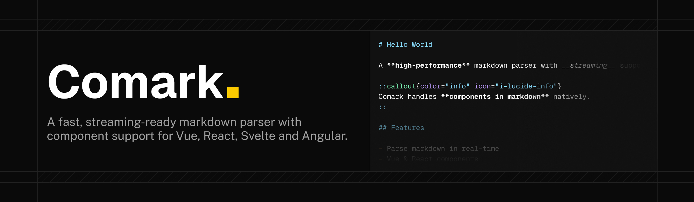

# @comark/angular

[](https://npmx.dev/@comark/angular)
[](https://npm.chart.dev/@comark/angular)
[](https://github.com/comarkdown/comark/actions/workflows/ci.yml)
[](https://comark.dev/rendering/angular)
[](https://github.com/comarkdown/comark/blob/main/LICENSE)

Angular 21+ renderer for [Comark](https://comark.dev). Render Markdown with custom standalone components, streaming support, and SSR.

## Features

- `<comark-markdown>` standalone component for rendering Markdown
- Custom Angular components for any Comark tag
- Streaming support with auto-close and stream effects such as caret and fade via `comark/stream`
- SSR support with Angular 21+ standalone components
- Plugins for math, Mermaid, Shiki highlighting, binding, and more
- Full TypeScript support

## Installation

```bash
npm install @comark/angular
# or
pnpm add @comark/angular
```

## Usage

```typescript
import { Component } from '@angular/core'
import { Markdown } from '@comark/angular'
import { math, Math } from '@comark/angular/plugins/math'

@Component({
  selector: 'app-root',
  standalone: true,
  imports: [Markdown],
  template: `<comark-markdown [value]="content" [components]="{ Math }" [plugins]="[math()]" />`,
})
export class AppComponent {
  content = `# Hello\n\nThis is **Comark** in Angular.`
}
```

### Custom components

```typescript
import { Component } from '@angular/core'
import { Markdown } from '@comark/angular'
import { AlertComponent } from './alert.component'

@Component({
  selector: 'app-root',
  standalone: true,
  imports: [Markdown],
  template: `<comark-markdown [value]="content" [components]="{ alert: AlertComponent }" />`,
})
export class AppComponent {
  content = `
::alert{type="warning"}
Heads up!
::
`
}
```

### Streaming

```typescript
import { Component } from '@angular/core'
import { Markdown } from '@comark/angular'
import { caret } from 'comark/stream'

@Component({
  selector: 'app-chat',
  standalone: true,
  imports: [Markdown],
  template: `<comark-markdown [value]="content" [streaming]="isStreaming" [effects]="effects" />`,
})
export class ChatComponent {
  effects = [caret()]
  content = ''
  isStreaming = true
}
```

## Documentation

Full guide and API reference at [comark.dev/rendering/angular](https://comark.dev/rendering/angular).

## License

Made with ❤️

Published under [MIT License](https://github.com/comarkdown/comark/blob/main/LICENSE).
