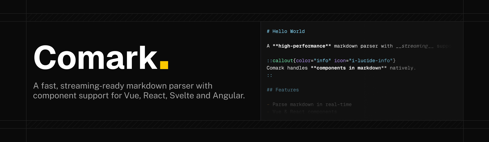

# @comark/nuxt

[](https://npmx.dev/@comark/nuxt)
[](https://comark.dev/rendering/vue#nuxt)
[](https://github.com/comarkdown/comark/blob/main/LICENSE)

> [!WARNING]
> `@comark/nuxt` is deprecated. The Nuxt module now ships in [`@comark/vue`](https://comark.dev/rendering/vue#nuxt).

This package only installs the `@comark/vue` Nuxt module and logs a deprecation warning.

## Migrate to `@comark/vue`

1. Replace the dependency:

   ```bash
   npm uninstall @comark/nuxt
   npm install @comark/vue
   ```

2. Replace the module in `nuxt.config.ts`. Nuxt loads `@comark/vue/nuxt` automatically:

   ```ts
   export default defineNuxtConfig({
     modules: ['@comark/vue'],
   })
   ```

3. Replace `@comark/nuxt/*` imports with `@comark/vue/*`, for example `@comark/nuxt/plugins/math` with `@comark/vue/plugins/math`.

4. The module no longer registers `~/components/prose` as a global components directory. Pass the components to `<Markdown>` with the `components` prop, or register the directory yourself:

   ```ts
   export default defineNuxtConfig({
     modules: ['@comark/vue'],
     components: [{ path: '~/components/prose', global: true, pathPrefix: false }, '~/components'],
   })
   ```

`<Markdown>`, `<MarkdownDocument>`, `defineMarkdownComponent()` and `defineMarkdownDocumentComponent()` are still auto-imported, and Nuxt UI prose components are still turned on when `@nuxt/ui` is installed.

## License

Made with ❤️

Published under [MIT License](https://github.com/comarkdown/comark/blob/main/LICENSE).
