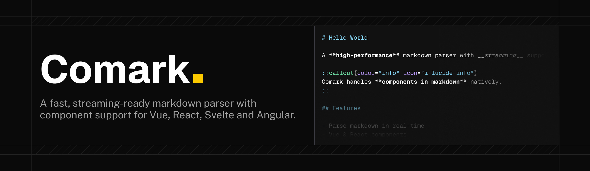

# @comark/svelte

[](https://npmx.dev/@comark/svelte)
[](https://npm.chart.dev/@comark/svelte)
[](https://github.com/comarkdown/comark/actions/workflows/ci.yml)
[](https://comark.dev/rendering/svelte)
[](https://github.com/comarkdown/comark/blob/main/LICENSE)

Svelte 5 renderer for [Comark](https://comark.dev). Render Markdown with custom Svelte components, streaming support, and SvelteKit SSR.

## Features

- `<Markdown>` component for rendering Markdown
- Custom Svelte components for any Comark tag
- Streaming support with auto-close and stream effects such as caret and fade via `comark/effects`
- SvelteKit SSR support
- Plugins for math, Mermaid, Shiki highlighting, binding, and more
- Full TypeScript support

## Installation

```bash
npm install @comark/svelte
# or
pnpm add @comark/svelte
```

## Usage

```svelte
<script lang="ts">
  import { Markdown } from '@comark/svelte'
  import math, { Math } from '@comark/svelte/plugins/math'

  const content = `# Hello\n\nThis is **Comark** in Svelte.`
</script>

<Markdown value={content} components={{ math: Math }} plugins={[math()]} />
```

### Custom components

```svelte
<script lang="ts">
  import { Markdown } from '@comark/svelte'
  import Alert from './Alert.svelte'
</script>

<Markdown value={content} components={{ alert: Alert }} />
```

```mdc
::alert{type="warning"}
Heads up!
::
```

### Streaming

`Markdown` and `MarkdownAsync` reuse completed blocks while `streaming` is true. Set it to false when the stream ends to run a final full parse. Changes to `options`, `plugins`, or `unwrap` create a new parser. Heading tails and reference definitions use a full parse to preserve heading IDs and links.

```svelte
<script lang="ts">
  import { Markdown } from '@comark/svelte'
  import { caret } from 'comark/effects'

  const effects = [caret()]
</script>

<Markdown value={content} streaming={isStreaming} {effects} />
```

## Documentation

Full guide and API reference at [comark.dev/rendering/svelte](https://comark.dev/rendering/svelte).

## License

Made with ❤️

Published under [MIT License](https://github.com/comarkdown/comark/blob/main/LICENSE).
