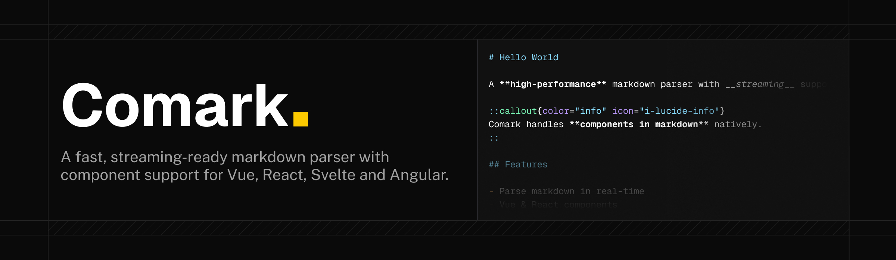

# @comark/vue

[](https://npmx.dev/@comark/vue)
[](https://npm.chart.dev/@comark/vue)
[](https://github.com/comarkdown/comark/actions/workflows/ci.yml)
[](https://comark.dev/rendering/vue)
[](https://github.com/comarkdown/comark/blob/main/LICENSE)

Vue 3 renderer for [Comark](https://comark.dev). Render Markdown with custom Vue components, streaming support, and SSR.

## Features

- `<Markdown>` component for rendering Markdown
- Custom Vue components for any Comark tag
- Streaming support with auto-close and stream effects such as caret and fade via `comark/stream`
- SSR support in Nuxt and Vite
- Optional Vite plugin for `<slot unwrap>` and prose component registration
- Plugins for math, Mermaid, Shiki highlighting, binding, and more

## Installation

```bash
npm install @comark/vue
# or
pnpm add @comark/vue
```

## Usage

```vue
<script setup lang="ts">
import { Markdown } from '@comark/vue'
import math, { Math } from '@comark/vue/plugins/math'

const content = `# Hello\n\nThis is **Comark** in Vue.`
</script>

<template>
  <Markdown :components="{ math: Math }" :plugins="[math()]">
    {{ content }}
  </Markdown>
</template>
```

### Custom components

```vue
<script setup lang="ts">
import { Markdown } from '@comark/vue'
import Alert from './components/Alert.vue'
</script>

<template>
  <Markdown :components="{ alert: Alert }">{{ content }}</Markdown>
</template>
```

```mdc
::alert{type="warning"}
Heads up!
::
```

### Streaming

```vue
<script setup lang="ts">
import { Markdown } from '@comark/vue'
import { caret } from 'comark/stream'

const effects = [caret()]
</script>

<template>
  <Markdown :streaming="isStreaming" :effects="effects">{{ content }}</Markdown>
</template>
```

## Using with Vite

`@comark/vue` ships an optional Vite plugin that:

- Enables `<slot unwrap="...">` inside custom Markdown components.
- Auto-registers every `.vue` file under `src/components/prose` (or `components/prose`) as a global component.

```ts
// vite.config.ts
import { defineConfig } from 'vite'
import vue from '@vitejs/plugin-vue'
import comark from '@comark/vue/vite'

export default defineConfig({
  plugins: [vue(), comark()],
})
```

Pass `comark({ prose: false })` to opt out of the auto-registered prose components.

## Using with Nuxt

Add `@comark/vue` to your Nuxt modules. Nuxt loads `@comark/vue/nuxt`, which auto-imports `<Markdown>`, `<MarkdownDocument>`, `defineMarkdownComponent()`, and `defineMarkdownDocumentComponent()`:

```ts
// nuxt.config.ts
export default defineNuxtConfig({
  modules: ['@comark/vue'],
})
```

## Documentation

Full guide and API reference at [comark.dev/rendering/vue](https://comark.dev/rendering/vue).

## License

Made with ❤️

Published under [MIT License](https://github.com/comarkdown/comark/blob/main/LICENSE).
