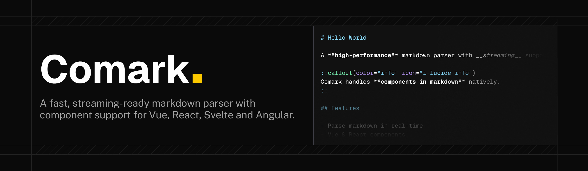

# comark

[](https://npmx.dev/comark)
[](https://npmx.dev/package-stats/comark/v/latest?granularity=monthly)
[](https://github.com/comarkdown/comark/actions/workflows/ci.yml)
[](https://app.codspeed.io/comarkdown/comark)
[](https://comark.dev)
[](https://github.com/comarkdown/comark/blob/main/LICENSE)

Comark is an open-source Markdown parser and renderer with components, attributes, and plugins. It streams AI output to React, Vue, Svelte, Angular, HTML, and the terminal.

Comark parses CommonMark and GFM into a compact, serializable document at build time, at runtime, or during a stream. Render the same document across targets, or extend the syntax with components and attributes when you need custom UI.

```mdc
# Regular Markdown

With a custom component:

::alert{type="warning"}
This is **Markdown** inside your own component.
::
```

## Why Comark

- **Runtime parsing**: `parseMarkdown(markdown)` is a pure function returning a compact, serializable Markdown document. Content from a database, CMS, or LLM is live the moment it is saved. No rebuild, no redeploy. ([Comark vs MDX](https://comark.dev/compare/comark-vs-mdx))
- **Streaming built in**: auto-close completes unterminated syntax (`**bold`, open code fences, half-open components) so AI output renders correctly at every frame.
- **One parser, every renderer**: the same source renders to HTML, ANSI, Vue, React, Svelte, and Angular. Your content outlasts your framework.
- **Standard Markdown**: CommonMark and GFM ([with a few differences](https://comark.dev/syntax/markdown#differences-from-commonmark-and-gfm)), frontmatter, and `{.class}` attributes on native elements. Components are opt-in syntax, not a new language.
- **Plugin ecosystem**: Shiki highlighting, KaTeX math, Mermaid diagrams, TOC, alerts, footnotes, and more, plus compatibility with existing markdown-it plugins.
- **Decoupled parse and render**: parse once on the server, send the serializable document (`['tag', props, ...children]`) to the client, and render without re-parsing.
- **Fast**: built on [markdown-exit](https://github.com/serkodev/markdown-exit), a TypeScript rewrite of markdown-it, with full TypeScript support.

The component and attribute syntax builds on five years of production use in [MDC](https://github.com/nuxt-content/mdc). Read [Why Comark](https://comark.dev/kb/why-comark) for the background.

## Quick start

```bash
npm install comark
```

```ts
import { parseMarkdown } from 'comark'

const tree = await parseMarkdown('# Hello **World**')
// { nodes: [['h1', { id: 'hello' }, 'Hello ', ['strong', {}, 'World']]], frontmatter: {}, meta: {} }
```

Then pick a renderer:

### Vue

```bash
npm install @comark/vue katex
```

```vue
<script setup lang="ts">
import { Markdown } from '@comark/vue'
import math, { Math } from '@comark/vue/plugins/math'

const chatMessage = ...
</script>

<template>
  <Markdown :components="{ Math }" :plugins="[math()]">{{ chatMessage }}</Markdown>
</template>
```

### React

```bash
npm install @comark/react katex
```

```tsx
import { Markdown } from '@comark/react'
import math, { Math } from '@comark/react/plugins/math'

function App() {
  const chatMessage = ...
  return <Markdown components={{ Math }} plugins={[math()]}>{chatMessage}</Markdown>
}
```

### Svelte

```bash
npm install @comark/svelte katex
```

```svelte
<script lang="ts">
  import { Markdown } from '@comark/svelte'
  import math, { Math } from '@comark/svelte/plugins/math'

  const chatMessage = ...
</script>

<Markdown value={chatMessage} components={{ math: Math }} plugins={[math()]} />
```

### Angular

```bash
npm install @comark/angular katex
```

```typescript
import { Component } from '@angular/core'
import { Markdown } from '@comark/angular'
import { math, Math } from '@comark/angular/plugins/math'

@Component({
  selector: 'app-chat',
  standalone: true,
  imports: [Markdown],
  template: `<comark-markdown [value]="chatMessage" [components]="{ Math }" [plugins]="[math()]" />`,
})
export class ChatComponent {
  chatMessage = ...
}
```

### HTML (no framework)

```bash
npm install @comark/html
```

```js
import { renderHtml } from '@comark/html'

const chatMessage = ...

const html = await renderHtml(chatMessage)
```

## Packages

| Package | Description |
|---|---|
| [`comark`](https://comark.dev/reference/parse) | Core parser, AST utilities, and plugins |
| [`@comark/vue`](https://comark.dev/rendering/vue) | Vue 3 renderer and Nuxt module |
| [`@comark/react`](https://comark.dev/rendering/react) | React renderer (Next.js, Server Components) |
| [`@comark/svelte`](https://comark.dev/rendering/svelte) | Svelte 5 renderer |
| [`@comark/angular`](https://comark.dev/rendering/angular) | Angular 21+ renderer |
| [`@comark/html`](https://comark.dev/rendering/html) | HTML string renderer |
| [`@comark/ansi`](https://comark.dev/rendering/ansi) | ANSI terminal renderer |

## Agent skill

Coding agents can install the Comark skill from the docs site:

```bash
npx skills add https://comark.dev
```

See [Installation](https://comark.dev/getting-started/installation) on comark.dev for details.

## License

Made with ❤️

Published under [MIT License](https://github.com/comarkdown/comark/blob/main/LICENSE).
